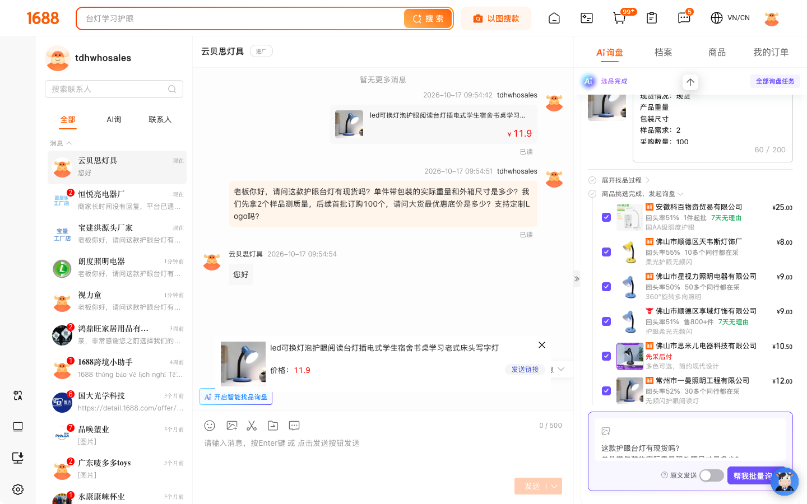

<div align="center">

# 🇨🇳 CHINA SOURCING SUITE (`china-sourcing`)

### Biến AI Agent thành giám đốc thu mua hàng Trung Quốc đa sàn 24/7
*(Tự động săn xưởng gốc 1688 ➔ Bắt trend Douyin/Taobao/Pinduoduo ➔ Tính giá vốn về kho VN ➔ Tự chat WangWang ép giá & canh phản hồi 5 phút/lần)*

[](https://opensource.org/licenses/MIT)
[](https://github.com/abm-dungtq/china-sourcing)
[](https://github.com/abm-dungtq/china-sourcing)
[](https://t.me/dungtq87)

*Bạn chỉ cần ra lệnh bằng tiếng Việt. AI tự dịch từ khóa chuyên ngành, lọc bỏ con buôn trung gian, bóc tách trọng lượng đóng gói thực tế, tính giá về tay bằng VNĐ và trực tiếp đàm phán với chủ xưởng Trung Quốc trên 1688 WangWang.*

---

[Vì sao cần cài ngay?](#vi-sao-can-cai) • [5 vũ khí săn hàng](#5-vu-khi) • [Bằng chứng thực chiến](#bang-chung-thuc-chien) • [Cài đặt 1 chạm](#cai-dat) • [Câu lệnh mẫu copy-chạy-ngay](#cau-lenh-mau) • [Biểu phí & hỗ trợ OEM](#bieu-phi-oem)

---

</div>

<a id="vi-sao-can-cai"></a>
## 🔥 1. Chấm dứt cảnh "mò kim đáy bể" khi tìm nguồn hàng Trung Quốc

90% người mới nhập hàng Trung Quốc mất tiền oan vì ba cái bẫy quen thuộc. Họ thường mua nhầm shop thương mại đội lốt nhà máy trên 1688 với giá cao hơn từ 25% tới 40%, ước lượng sai cân nặng đóng gói khiến tiền cước vận chuyển ăn cụt lợi nhuận hoặc mất hàng giờ dùng công cụ dịch máy ngô nghê để chat hỏi từng xưởng trên WangWang.

**`china-sourcing`** giải quyết triệt để bài toán đó bằng cách gắn trực tiếp năng lực thu mua xuyên biên giới vào AI Agent mà bạn đang dùng hằng ngày (Claude Code, Google Antigravity, OpenAI Codex, Cursor, OpenCode). Bạn chỉ cần đưa ra yêu cầu bằng tiếng Việt tự nhiên, mọi khâu kỹ thuật phía sau sẽ do AI tự động đảm nhiệm.

|Cách làm thủ công truyền thống|Khi cài đặt `china-sourcing` vào AI Agent|
|:---|:---|
|Tự dùng Google Dịch mò từ khóa, ra toàn shop bán lẻ giá cao.|AI tự lập ma trận **từ khóa tiếng Trung chuyên ngành của xưởng** và bật bộ lọc cứng chỉ lấy **Nhà máy sản xuất (`生产厂家`)**.|
|Không biết 1 chiếc nặng bao nhiêu gram, về đến kho Việt Nam mới ngã ngửa vì phí cân nặng.|AI tự vào trang chi tiết bóc tách **trọng lượng thực tế kèm hộp** và tính sẵn **giá vốn về kho VN (VNĐ)** theo cả tuyến TMĐT lẫn Chính ngạch.|
|Phải tự mở từng cửa sổ WangWang, copy-paste câu hỏi và ngồi trực màn hình chờ xưởng trả lời.|AI **tự mở 1688 WangWang gửi tin hỏi giá**, **chụp ảnh màn hình chứng minh** rồi **cứ 5 phút tự quét hộp thư 1 lần** để dịch báo cáo lại cho bạn.|
|Phải gõ lệnh Terminal phức tạp hoặc quét mã QR lỗi font trong màn hình đen.|Cần đăng nhập là AI **tự bật cửa sổ Chrome thật trên màn hình**, chờ bạn quét QR xong rồi tự chạy tiếp mà không cần gõ bất kỳ lệnh Terminal nào.|

---

<a id="5-vu-khi"></a>
## ⚡ 2. Năm vũ khí săn hàng xuyên biên giới trong 1 bộ kỹ năng

$$\mathbf{[Douyin/Taobao\ Trend]} \longrightarrow \mathbf{[1688\ Factory\ Filter]} \longrightarrow \mathbf{[VN\ Landed\ Cost]} \longrightarrow \mathbf{[WangWang\ Auto\ Chat]} \longrightarrow \mathbf{[5\text{-}Min\ Reply\ Radar]}$$

Bộ kỹ năng kết nối trực tiếp 5 sàn thương mại điện tử lớn nhất Trung Quốc vào một luồng làm việc duy nhất:

1. **Lọc xưởng sản xuất tận gốc trên 1688 (`--factory-only`):** Loại bỏ hoàn toàn các công ty thương mại mua đi bán lại. Hệ thống tự trích xuất bậc giá EXW, sản lượng đã bán, số năm hoạt động và thông số đóng gói của từng SKU.
2. **Tìm nguồn hàng bằng hình ảnh (Reverse Image Search):** Thả 1 bức ảnh sản phẩm đang bán chạy trên Shopee/TikTok Shop hoặc dán link ảnh, AI lập tức truy ra các nhà máy 1688 đang đúc khuôn mẫu đó.
3. **Bóc kịch bản video bán hàng triệu view trên Douyin:** Tải video Douyin không dính watermark và chuyển toàn bộ lời thoại bán hàng tiếng Trung thành văn bản để bạn lấy ý tưởng làm video affiliate hoặc bán hàng tại Việt Nam.
4. **Giải mã link chia sẻ điện thoại đa sàn (Taobao • Tmall • Pinduoduo • Alibaba):** Dán nguyên đoạn chữ lộn xộn copy từ app điện thoại (`【淘宝】https://e.tb.cn/...`), AI tự bóc tách mã sản phẩm, khảo sát đánh giá người mua thật và tìm xưởng sỉ tương ứng trên 1688.
5. **Đàm phán WangWang tự động & radar canh tin 5 phút/lần:** Tự động gửi thẻ sản phẩm kèm câu hỏi ép giá mẫu, hỏi MOQ in Logo OEM trên **1688 WangWang (`旺旺`)**, chụp ảnh màn hình làm bằng chứng và tự động kiểm tra tin trả lời của chủ xưởng mỗi 5 phút.
6. **Radar quét sản phẩm mới đang hot, lượt bán tăng nhanh & bắt trend ngách 1688 (`trends`):** Tự động bóc tách tín hiệu sản phẩm mới lên kệ (`上新热销`), chấm điểm tốc độ tăng trưởng đơn hàng 30 ngày (`飙升 VelocityIndex` + theo dõi `Δ đơn/ngày`), gom cụm từ khóa ngách đang lên (`商机组货`) và trích xuất bộ 3 bảng xếp hạng chính thức 1688 (`热销榜`, `飙升榜`, `新品榜`) kèm giá vốn về kho Việt Nam.

---

<a id="bang-chung-thuc-chien"></a>
## 📸 3. Bằng chứng thực chiến tìm 5 xưởng đèn bàn chống cận dưới 35 tệ

Chỉ với 2 câu lệnh tiếng Việt ngắn gọn trong khung chat:
- **Câu 1:** *"Tìm giúp tôi 5 xưởng sản xuất đèn bàn học chống cận trên 1688, giá tại xưởng dưới 35 tệ, tính giá vốn về kho Việt Nam cho lô 100 chiếc."*
- **Câu 2:** *"Gửi tin hỏi giá đi, chụp ảnh chứng minh bạn đã hỏi."*

Trong chưa đầy 3 phút, `china-sourcing` đã lọc ra 5 nhà máy sản xuất trực tiếp tại Thâm Quyến, Trung Sơn, Phật Sơn và Sán Đầu. Hệ thống tính chi tiết giá vốn về kho Việt Nam cho lô 100 chiếc rồi trực tiếp mở **1688 WangWang** nhắn tin đàm phán với cả 5 chủ xưởng.

<div align="center">
  
  <p><em>Ảnh chụp màn hình thực tế do AI tự động xuất ra sau khi gửi tin nhắn hỏi giá lô 100 chiếc và điều kiện in Logo OEM cho 5 xưởng trên 1688 WangWang.</em></p>
</div>

Ngay ở chu kỳ quét tự động 5 phút đầu tiên, hệ thống đã thu về phản hồi trực tiếp của các chủ xưởng và dịch sang tiếng Việt cho người dùng:
- **Xưởng #2 (`中山市辰视灯饰厂` - Giá EXW `¥16.50`, Giá về VN `81.240đ/chiếc`):** Chủ xưởng xác nhận *"In Logo 1 màu làm được luôn cho đơn 100 chiếc (`单色logo 可以`), hàng đang có sẵn trong kho (`有货的`)!"*
- **Xưởng #4 (`汕头市宝建源科技有限公司` - Giá EXW `¥17.96`):** Báo rõ *"In màu cần 1.000 chiếc, còn khắc Laser màu xám nhận làm ngay cho lô 100 chiếc (`镭雕需要排单`)."*
- **Xưởng #5 (`佛山市云贝思照明有限公司` - Giá EXW `¥11.90`, Giá về VN `67.340đ/chiếc`):** Xác nhận nhận đơn lấy 2 mẫu test và đặt 100 chiếc kèm in Logo (`可以的`).

---

<a id="cai-dat"></a>
## 🚀 4. Hướng dẫn cài đặt 1 chạm (Hỗ trợ mọi AI Agent)

### Cách 1 cài đặt tự động bằng 1 dòng lệnh (Khuyên dùng)
Mở Terminal và dán lệnh dưới đây. Script sẽ tự động cài đặt `china-sourcing` vào **Claude Code, Google Antigravity, OpenAI Codex, Cursor, OpenCode** cùng bộ công cụ `1688-cli` và `douyin-mcp-server`.

```bash
curl -fsSL https://raw.githubusercontent.com/abm-dungtq/china-sourcing/main/scripts/install.sh | bash
```

### Cách 2 clone kho mã nguồn và cài đặt thủ công
Nếu bạn muốn lưu mã nguồn về máy để tùy chỉnh thêm, hãy chạy 3 lệnh sau:

```bash
git clone https://github.com/abm-dungtq/china-sourcing.git
cd china-sourcing
bash scripts/install.sh
```

> 💡 **Trải nghiệm đăng nhập Zero-Terminal:** Sau khi cài xong, bạn **không cần** chạy bất kỳ lệnh đăng nhập nào trong Terminal. Khi bạn giao việc lần đầu trên 1688, AI Agent sẽ tự động bật cửa sổ trình duyệt Chrome trên màn hình để bạn quét mã QR (hoặc nhập mật khẩu/SMS), tự xác nhận khi bạn đăng nhập xong và lưu phiên cố định cho mọi lần sau.

---

<a id="cau-lenh-mau"></a>
## 💬 5. Sáu câu lệnh mẫu copy-chạy-ngay trong khung chat AI

Sau khi cài đặt, hãy mở khung chat của Claude Code, Antigravity hoặc Cursor và thử ngay một trong các câu lệnh dưới đây:

1. **Săn xưởng gốc 1688 & tính giá vốn về Việt Nam:**
   ```text
   Tìm giúp tôi 5 xưởng sản xuất quạt cầm tay mini tích điện trên 1688, giá tại xưởng dưới 25 tệ, tính giá vốn về kho Việt Nam cho lô 200 chiếc.
   ```
2. **Quét sản phẩm mới đang hot, lượt bán tăng nhanh & bắt trend ngách 1688 (`trends`):**
   ```text
   Quét giúp tôi các mẫu đèn bàn chống cận mới ra đang hot, lượt bán tăng nhanh nhất trên 1688 và các ngách xu hướng đang lên kèm giá vốn về Việt Nam cho lô 100 chiếc.
   ```
3. **Ủy quyền cho AI đi chat WangWang ép giá & canh tin 5 phút/lần:**
   ```text
   Gửi tin hỏi giá sỉ lô 200 chiếc, lấy 2 mẫu test và hỏi điều kiện in Logo OEM cho 5 xưởng trên qua WangWang, chụp ảnh màn hình chứng minh bạn đã hỏi.
   ```
4. **Tìm xưởng 1688 bằng hình ảnh sản phẩm có sẵn:**
   ```text
   Tìm các xưởng 1688 đang sản xuất mẫu sản phẩm giống hệt bức ảnh /đường/dẫn/anh-san-pham.jpg và so sánh 5 xưởng có tỷ lệ khách mua lại cao nhất.
   ```
5. **Dò giá sỉ 1688 từ link chia sẻ điện thoại Taobao / Pinduoduo:**
   ```text
   Giải mã link chia sẻ Taobao này, bóc tách thông số sản phẩm và tìm xem các xưởng gốc trên 1688 đang bỏ sỉ mặt hàng này giá bao nhiêu.
   ```
6. **Bóc tách kịch bản video bán hàng hot trend trên Douyin:**
   ```text
   Tải video Douyin không logo từ link này và trích xuất toàn bộ kịch bản lời thoại bán hàng để tôi phân tích USP làm video TikTok.
   ```

---

<a id="bieu-phi-oem"></a>
## 📦 6. Biểu phí vận chuyển Trung - Việt chuẩn & hỗ trợ nhập khẩu / OEM

Công cụ tính giá vốn của `china-sourcing` được tích hợp sẵn biểu phí vận chuyển thực tế về kho Việt Nam. Nhờ đó, bạn tính được chính xác biên lợi nhuận ròng trên từng sản phẩm trước khi xuống tiền đặt hàng:

|Hạng mục|Đơn giá áp dụng trong Skill|Ghi chú chi tiết|
|:---|:---|:---|
|**Tỷ giá Nhân dân tệ (CNY)**|**`4.000đ / 1 CNY`**|Liên hệ **[https://t.me/dungtq87](https://t.me/dungtq87)** nếu cần hỗ trợ đổi tệ hoặc thanh toán hộ 1688/Taobao/Alipay.|
|**Hàng đi tuyến TMĐT**|**`30.000đ / 1 kg`**|Phù hợp đi hàng mẫu, đơn test thị trường, lô hàng nhỏ cần về nhanh.|
|**Hàng đi tuyến Chính ngạch (Đơn hàng trên $1\text{ m}^3$)**|**`1.600.000đ / 1 m³`** hoặc **`6.000đ / 1 kg`** + **Thuế VAT** + **Phí dịch vụ**|Đầy đủ hóa đơn VAT, tờ khai hải quan và chứng từ nhập khẩu chính ngạch cho doanh nghiệp.|
|**Đặt xưởng OEM & Nhập khẩu trọn gói**|[https://t.me/dungtq87](https://t.me/dungtq87)|Hỗ trợ đàm phán nhà máy, kiểm hàng tại xưởng, in thương hiệu OEM riêng và vận chuyển về tận kho Việt Nam.|

---

<div align="center">

### 🤝 Cần hỗ trợ vận chuyển, nhập khẩu chính ngạch hoặc làm hàng OEM?
Liên hệ trực tiếp qua Telegram: **[https://t.me/dungtq87](https://t.me/dungtq87)**

*Phát triển bởi **ABM.DungTQ** • Tuân thủ chuẩn **Khung Prompt 06 Thành Phần** & **Chuẩn thiết kế Workflow ABM v1.0**.*

</div>
