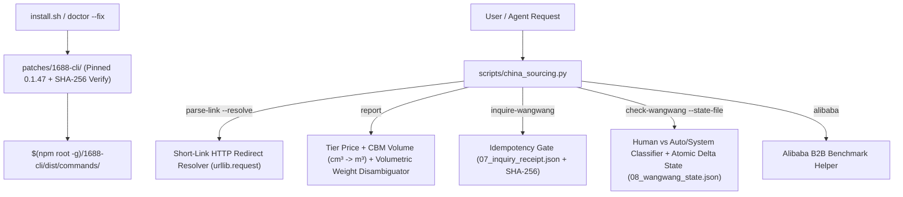

# Implementation Plan: China Sourcing v2.0 Upgrade (`--advice` Handover-Ready)

This plan materializes the winning `ak:brainstorm --ultra --advice` contract (`Candidate A` + `Candidate E`'s `doctor --fix` & 8 regression unit tests) and is **handover-ready** for downstream execution under `/ak:cook --advice --auto`. Every phase file includes explicit per-task Goals, Target files & symbols, step-by-step instructions, mechanical `Verify` pass conditions, and the mandatory `## Failure Protocol` block.

## 1. Architecture & Dataflow Overview

## 2. Phase Index & Ownership Matrix

| Phase | File | Priority | Effort | Owned Files | Mechanical Verification Gate |
| :--- | :--- | :---: | :---: | :--- | :--- |
| **Phase 1** | [`phase-01-vendor-patch-and-repo-hygiene.md`](file:///Volumes/1/AGY/china-sourcing/plans/20261017-1152-china-sourcing-v2-upgrade/phase-01-vendor-patch-and-repo-hygiene.md) | P1 | 1h | `patches/1688-cli/*`, `scripts/install.sh`, `docs/*`, `assets/*`, `examples/run-20261017-0831-den-ban-chong-can/*` | `python3 scripts/china_sourcing.py doctor --fix` exits 0 and prints `"patched": true` |
| **Phase 2** | [`phase-02-landed-cost-math-and-shortlink-resolver.md`](file:///Volumes/1/AGY/china-sourcing/plans/20261017-1152-china-sourcing-v2-upgrade/phase-02-landed-cost-math-and-shortlink-resolver.md) | P1 | 1h | `scripts/china_sourcing.py` (pricing, weight, CBM, short-link resolver, `alibaba` subcommand) | `python3 -m unittest discover -s scripts/tests -v` exits 0 with tier/CBM/weight/short-link tests passing |
| **Phase 3** | [`phase-03-stateful-wangwang-cli-and-test-suite.md`](file:///Volumes/1/AGY/china-sourcing/plans/20261017-1152-china-sourcing-v2-upgrade/phase-03-stateful-wangwang-cli-and-test-suite.md) | P1 | 1h | `scripts/china_sourcing.py` (`inquire-wangwang`, `check-wangwang`), `scripts/tests/test_china_sourcing.py`, `SKILL.md`, `references/platform-playbooks.md` | `python3 -m unittest discover -s scripts/tests -v` exits 0 with $\ge 18$ tests passing and `bash scripts/install.sh` syncs cleanly |

## 3. Acceptance Criteria Checklist

- [x] **AC-1 (Portable `1688-cli` Patch):** `patches/1688-cli/` stores the 3 patched command files (`seller-chat.js`, `seller-inquire.js`, `seller-messages.js`) and `patch-meta.json` for `1688-cli@0.1.47`; `python3 scripts/china_sourcing.py doctor --fix` verifies and applies them idempotently.
- [x] **AC-2 (Accurate Landed-Cost & Report Math):** `generate_sourcing_report()` selects the matching `priceTiers` entry for `target_qty`, converts `packageInfo[].volume` ($\text{cm}^3 \to \text{m}^3$), and disambiguates gram vs. kg weights (including items $\le 10\text{g}$) using `freight.unitWeight`, unit suffixes, and volumetric weight $(L \times W \times H)/6000$.
- [x] **AC-3 (Stateful & Noise-Free WangWang):** `check-wangwang` separates `human_replies` from `auto_or_system_messages` (`autoReply`, `assessment`, `other`, `[卡片消息]`, `商家长时间没有回复`, `由于当前是节假日期间`) and tracks `seen_message_keys` via atomic `--state-file` writes to emit `new_human_replies`.
- [x] **AC-4 (Idempotent `inquire-wangwang` & `alibaba` Subcommands):** `inquire-wangwang` enforces `sha256(run_id + offer_id + inquiry_text_hash)` against `07_inquiry_receipt.json`, sets `BB1688_SCREENSHOT_PATH`, and blocks duplicate sends; `alibaba` subcommand aligns CLI with `references/platform-playbooks.md`.
- [x] **AC-5 (Short-Link Resolution):** `parse-link` supports `--resolve` (and `resolve_redirects=True`) using `urllib.request` with a 5s timeout, realistic mobile `User-Agent`, max 5 redirects, and safe offline fallback.
- [x] **AC-6 (Repo Hygiene & Comprehensive Tests):** Duplicate files in `docs/`, `assets/`, and `examples/run-20261017-0831-den-ban-chong-can/07_receipt_2..5.json` are cleaned up; `scripts/install.sh` excludes non-runtime folders when syncing to global agent skill directories; unit test suite in `scripts/tests/test_china_sourcing.py` passes $\ge 18$ tests.
