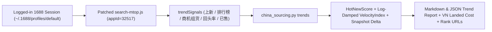

# Implementation Plan: China Sourcing v2.1.0 — 1688 Trend & Velocity Radar (`--advice` Handover Ready)

This plan is authored under the **`--advice` Handover Plan Contract** (`advice-handover-plan.md`) and supervised by `kongming`. Every phase file contains step-by-step tasks with exact file paths, symbol names, mechanical `Verify` pass conditions, and a literal `## Failure Protocol` block.

## 1. Reused Brainstorm Contract

- **Outcome:** Upgrade `china-sourcing` to `v2.1.0` so that once logged into 1688 (`~/.1688/profiles/default`), the skill can scan **Hot New Products (`new-hot`)**, **Fast-Rising Sales Velocity (`fast-rising`)**, and **Emerging Niche Trends & Leaderboards (`niche-trends`)** via `python3 scripts/china_sourcing.py trends`, fix the missing `repurchaseRate` in `1688-cli`, and provide comprehensive Vietnamese user documentation (`HUONG_DAN_SU_DUNG_CHINA_SOURCING.md`, `README.md`, `SKILL.md`, and `build_onboarding_guide()`).
- **Constraints:**
  - Zero external Python dependencies (Python 3.9+ stdlib only).
  - Vendored `1688-cli@0.1.47` patch (`search-mtop.js`) managed via `patches/1688-cli/patch-meta.json` and auto-applied by `doctor --fix` and `scripts/install.sh` (with automatic `1688 daemon reload` when patches are applied).
  - Log-damped `VelocityIndex` formula to prevent small-denominator illusion (`5/5 = 100%`) and bucket truncation (`> 1.0`).
- **Non-goals:**
  - No automated checkout/payment on 1688.
  - No paid 1688 membership requirement.
- **Acceptance Criteria:**
  1. `python3 scripts/china_sourcing.py doctor --fix` verifies and applies all 4 patched files (`seller-chat.js`, `seller-inquire.js`, `seller-messages.js`, `search-mtop.js`) across `dist/commands/` and `dist/session/`.
  2. Patched `search-mtop.js` extracts `trendSignals` (`newProductSellPoints`, `rankBadges`, `businessOppoTopics`, `priceCompetitiveBadges`, `soldCountTotal`, `soldCountText`, `kuaJingPuHuo`, `fenxiaoNewOffer`, `tradeScore`) and populates `demand.repurchaseRate` from `turnHead.percent` / `afterTags.text` / `offerRepurchaseRate`.
  3. `python3 scripts/china_sourcing.py trends` supports `--keyword`, `--mode {all,new-hot,fast-rising,niche-trends}`, `--max`, `--qty`, `--state-file` (for $\Delta\text{orders/day}$ snapshot tracking), `--input-json` (for offline/replay analysis), `--output-json`, and `--output-md`.
  4. User guides (`HUONG_DAN_SU_DUNG_CHINA_SOURCING.md`, `README.md`, `SKILL.md`, `references/platform-playbooks.md`, and `build_onboarding_guide()`) include clear copy-paste examples and CLI instructions for scanning hot products, fast-growing sales, and 1688 trends.
  5. Unit test suite (`scripts/tests/test_china_sourcing.py`) passes 100% (`>= 24` tests, `OK`).

## 2. Architecture & Data Flow

## 3. Phases Index

| Phase | File | Owner / Scope | Status |
| :--- | :--- | :--- | :--- |
| **Phase 1** | [`phase-01-vendor-patch-search-mtop.md`](file:///Volumes/1/AGY/china-sourcing/plans/261017-1524-1688-trend-velocity-radar/phase-01-vendor-patch-search-mtop.md) | `patches/1688-cli/search-mtop.js`, `patches/1688-cli/patch-meta.json`, `verify_and_patch_1688_cli` in `scripts/china_sourcing.py` | Completed |
| **Phase 2** | [`phase-02-trends-engine-and-cli.md`](file:///Volumes/1/AGY/china-sourcing/plans/261017-1524-1688-trend-velocity-radar/phase-02-trends-engine-and-cli.md) | `analyze_1688_trends`, `run_1688_trends`, `trends` CLI subcommand, and `report` trend badge enrichment in `scripts/china_sourcing.py` | Completed |
| **Phase 3** | [`phase-03-docs-user-guide-and-tests.md`](file:///Volumes/1/AGY/china-sourcing/plans/261017-1524-1688-trend-velocity-radar/phase-03-docs-user-guide-and-tests.md) | `HUONG_DAN_SU_DUNG_CHINA_SOURCING.md`, `README.md`, `SKILL.md`, `references/platform-playbooks.md`, `scripts/tests/test_china_sourcing.py`, global skill sync | Completed |

